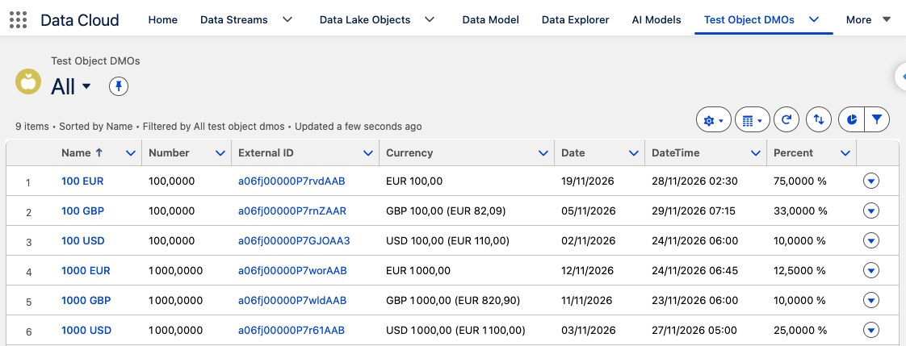
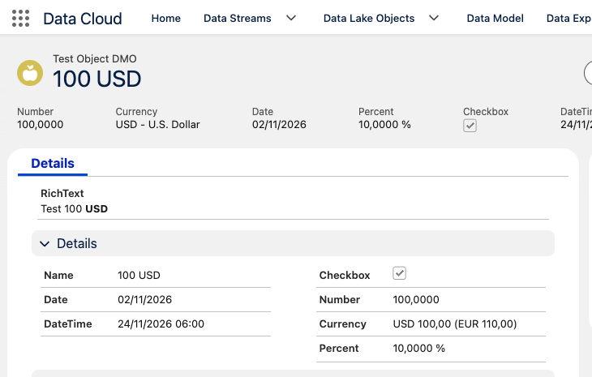
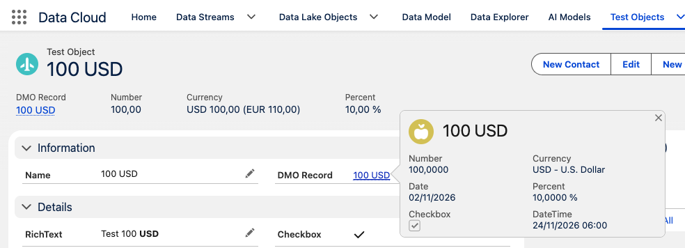
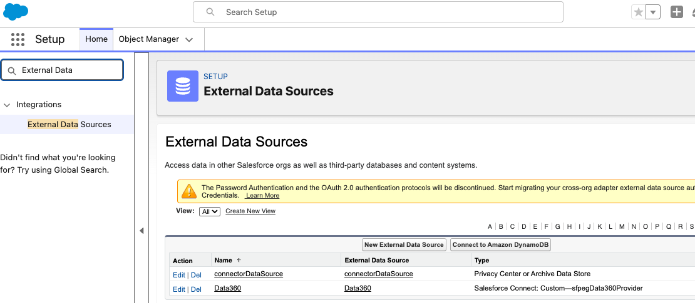
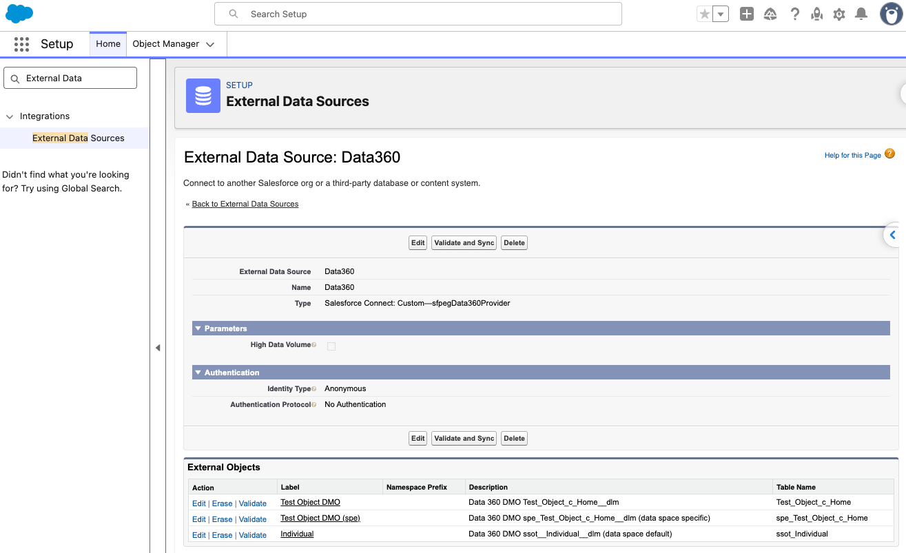
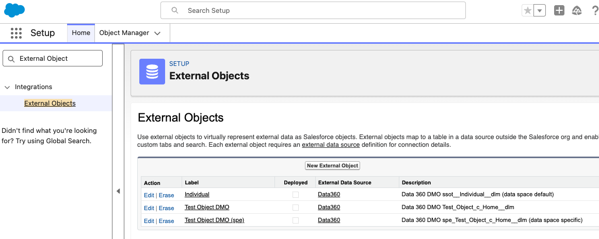
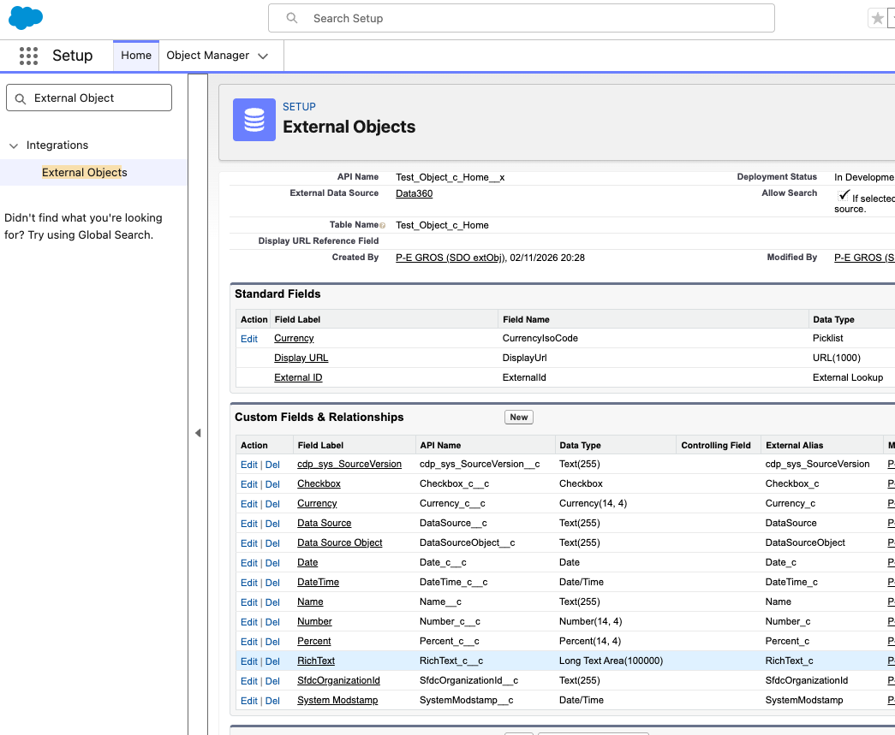

#  &nbsp; **sfpegData360Provider** Custom Apex Connector for Data360

This component is part of the **[PEG_DC_EXT](/README.md)** repository.

## Introduction

The **sfpegData360Provider** Apex Class is a custom
**[Apex Connector Framework](https://developer.salesforce.com/docs/atlas.en-us.apexcode.meta/apexcode/apex_connector_top.htm)**
adapter for **Salesforce Connect**. It enables to expose **Data 360** DMOs as
(read-only) **External Objects**, SOQL queries on these External Objects being translated
into ANSI SQL queries on the DMOs and executed via the
**[sfsqlquery](https://developer.salesforce.com/docs/data/data-cloud-query-guide/guide/dc-apex-query.html)**
Apex framework.

Typical use cases are:
* to display **Data 360** data as standard list views
* to query both local and **Data360** data via standard SOQL in Apex or Flows.

Such _External Objects_ based on Data360 DMOs may be displayed in Lightning
experience in: 
* standard list views

* standard record pages

* compact layouts for record lookup hovering

⚠️ This connector requires a **Salesforce Connect** license on production Orgs.

## Configuration

### External Data Source

An **External Data Source** should be created in Setup with:
* `Type` set to `sfpegData360Provider`
* `Identity Type` set to `Anonymous`

The **Validate and Sync** button then lists all DMOs available in all **Data 360** data
spaces, the selected ones being created as External Objects. Data spaces other than `default`
not accessible to the running user are ignored (see the `WARN` debug logs of the sync).

⚠️ After any DMO change (new DMO or field, type or label change...), a new
**Validate and Sync** is required to update the External Objects.

⚠️ The user executing the **Validate and Sync** needs access to the **Data 360** metadata
(e.g. via the _Data Cloud Architect_ or _Data Cloud User_ permission sets), otherwise an
_Insufficient Privileges_ error is raised.

Users should then be granted access to the External Objects and their fields
(e.g. via a permission set), as well as to the underlying **Data 360** data space.

### Exposed DMOs and Fields

Exposed DMOs and fields are **dynamically fetched** from the **Data 360** metadata via the standard
**[ConnectApi.CdpQuery.getAllMetadata()](https://developer.salesforce.com/docs/atlas.en-us.apexref.meta/apexref/apex_ConnectAPI_CdpQuery_static_methods.htm)**
method, i.e. all DMOs of all **Data 360** data spaces are proposed by default (the `default`
data space followed by the other active ones), with:
* their table name derived from the DMO name, without `__dlm` suffix and with single underscores
(e.g. `ssot__Account__dlm` exposed as `ssot_Account__x`)
* their column names derived the same way from the DMO field names, without `__c` suffix
(e.g. `ssot__Name__c` exposed as `ssot_Name__c`)
* their labels set to the DMO / DMO field display names
* their description indicating the DMO name and its data space
(e.g. `Data 360 DMO spe_Orders__dlm (data space specific)`), queries on the External
Object being executed on this data space
* their (single) primary key exposed as the standard `ExternalId` field, and their
`Name` field (e.g. `ssot__Name__c`) used as record name (`ExternalId` otherwise)
* their column types derived from the DMO field types (`Text` for text, email, phone...,
`Number` with 4 decimal places, `Boolean`, `DateTime` for date and datetime, `Url`)

ℹ️ Non `default` data spaces usually prefixing their DMO API names (e.g. `spe_Orders__dlm`),
their table names are unique. If a same DMO name exists in several data spaces, the `default`
data space one is kept (the other ones being ignored with a `WARN` debug log).

ℹ️ DMOs without a single primary key, DMO fields with names not supported by Salesforce
(e.g. too long, or conflicting with another column once derived) are silently ignored
(see the `WARN` debug logs of the sync).

ℹ️ By defaults, DMO fields are synced as simple base types, i.e. `numbers`, `datetime`, `text`. 
From Setup, it is later possible to modify the field types to `percent`, `currency`, `date`,
`checkbox`... to better match how they should be displayed in Lightning UX.

ℹ️ You may even define lookup relationship with Salesforce SObjects or replicate DMO relationships
in the field configuration (`lookup`or `external lookup` fields).

⚠️ Beware that `richtext` fields are not supported by external objects. Richtext fields remain
mapped as text fields but the **[sfpegRichTextDisplay](/help/sfpegRichTextDisplay.md)** LWC
component may be used to display their value properly in Lightning UX.

## Technical Details

The connector consists of the following Apex classes:
* **sfpegData360Provider** (`DataSource.Provider`) declaring the capabilities of the connector,
i.e. `ROW_QUERY` and `SEARCH` with `ANONYMOUS` authentication (read-only, no callout)
* **sfpegData360Connection** (`DataSource.Connection`) implementing:
    * `sync()` returning the DMOs of all data spaces (active `DataSpace` records, `default` first)
    fetched via `ConnectApi.CdpQuery.getAllMetadata()` as tables
    (with `ExternalId`, `DisplayUrl` and DMO field columns)
    * `query()` resolving the queried table and its data space via targeted `getAllMetadata()`
    calls (on the DMO names matching the table name, in
    the `default` data space first and then in the other ones), a full metadata fetch being
    done as last resort, the Connector Framework providing only the table name at query time
    * `query()` then translating SOQL queries into SQL queries and executing them via the
    **sfsqlquery.SqlStatement** class (with the `sfpegData360Connector` workload name)
    * `search()` relying on the standard `DataSource.SearchUtils.searchByName()` utility
* **sfpegData360SqlBuilder** translating the `DataSource.TableSelection` of SOQL queries
into SQL queries, i.e.:
    * selected columns into the `SELECT` list (`ExternalId` being always selected, `DisplayUrl` remaining empty)
    * `COUNT()` queries into `SELECT COUNT(*)` queries
    * filters into the `WHERE` clause, with `AND` / `OR` / `NOT` combinations, `=` / `!=`
    (`NULL` values included as in SOQL) / `<` / `<=` / `>` / `>=` operators and
    `LIKE` / contains / starts with / ends with operators (via case insensitive `ILIKE`)
    * orders into the `ORDER BY` clause (`NULL` values being sorted as in SOQL),
    `ExternalId` being used by default when an offset is requested
    * `LIMIT` / `OFFSET` from the query context (`2000` rows max by default)

Additional implementation details:
* DMO and field names are validated at metadata load (letters, digits and underscores
only), whereas filter values are typed and escaped (single quotes doubled, `LIKE` wildcards
escaped, numbers and booleans parsed) to prevent any SQL injection.
* `Date` values returned by **Data 360** are converted into `Datetime` values (midnight in the
running user time zone) for `DateTime` columns, and `Datetime` values into ISO strings for text columns.
* `Text` values longer than the column length (255 by default) are truncated.
* Metadata are loaded once per transaction.

These classes come with the **sfpegData360Connector_TST** test class, which relies on the 
standard **[sfsqlquery.SqlTester](https://developer.salesforce.com/docs/atlas.en-us.apexref.meta/apexref/apex_class_sfsqlquery_SqlTester.htm)**
class to mock Data 360 SQL responses, on a `MOCK_METADATA` test hook to mock DMO metadata
(`ConnectApi.CdpQuery` not being mockable).

⚠️ Standard Salesforce Connect limitations apply to the External Objects (no triggers,
limited formula / reporting support...) as well as hourly limits on the number of
External Object queries.
