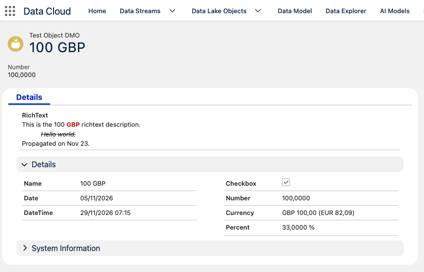
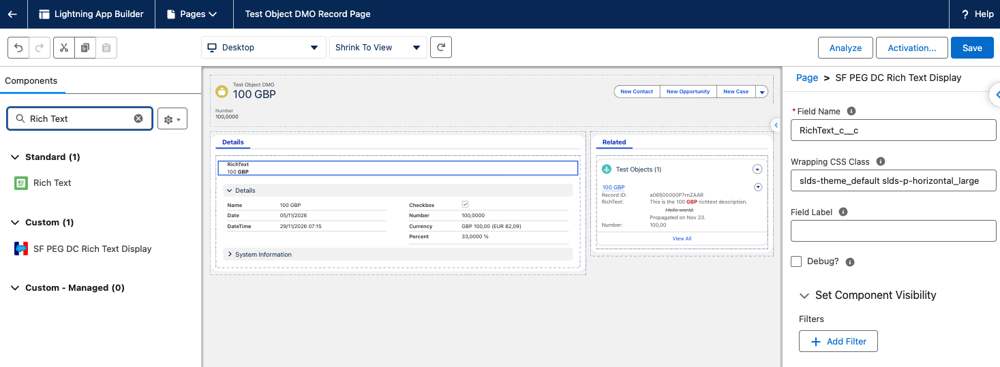

#  &nbsp; **sfpegRichTextDisplay** Rich Text Field Display Component

This component is part of the **[PEG_DC_EXT](/README.md)** repository.

## Introduction

The **sfpegRichTextDisplay** Lightning Web Component displays a rich text field of the current
record within a Lightning record page, with the same look & feel as a standard read-only
output field (i.e. field label above the formatted value).

It has been primarily designed for **External Object** record pages (e.g. **Data 360** DMOs
exposed via the **[sfpegData360Connector](/help/sfpegData360Connector.md)**), as rich text
content of External Object fields is otherwise displayed as raw HTML text in standard
record detail components. It however works on any object supported by the
**[User Interface API](https://developer.salesforce.com/docs/atlas.en-us.uiapi.meta/uiapi/ui_api_get_started.htm)**.

The field value is rendered via the standard
**[lightning-formatted-rich-text](https://developer.salesforce.com/docs/component-library/bundle/lightning-formatted-rich-text)**
base component, which sanitizes the HTML content and only keeps supported tags and attributes.

## Configuration

The component is available in **Lightning App Builder** for **record pages** under the
**SF PEG DC Rich Text Display** label.

Its configuration properties are the following:

| Property | Required | Default | Description |
|---|---|---|---|
| **Field Name** | ✅ | | API name of the rich text field to display (e.g. `Description__c`). A fully qualified `Object__x.Field__c` name is also supported. |
| **Wrapping CSS Class** | | `slds-theme_default slds-p-horizontal_large` | CSS classes applied to the wrapping `div` (e.g. to set background or padding consistent with other components of the page). |
| **Field Label** | | | Label displayed above the value. By default, the field label is fetched from the object metadata (field API name used as fallback). |
| **Debug?** | | `false` | Activates debug logs in the browser console. |

ℹ️ The `recordId` and `objectApiName` are automatically provided by the record page context
and do not need to be configured.

## Usage

Once configured, the component:
* displays the field label above the value, using standard **SLDS** read-only form element styling
* displays a spinner while the record data is being loaded
* displays the formatted rich text value (or an empty value if the field is not set)
* displays an error message in place of the value if the component is misconfigured
(e.g. missing **Field Name**) or if the record data cannot be fetched (e.g. invalid
field name or missing field access).

💡 Multiple instances of the component may be stacked on a page to display several rich text
fields, or combined with standard **Record Detail** / **Dynamic Forms** components.

## Technical Details

The component relies on standard **Lightning Data Service** wire adapters:
* **[getRecord](https://developer.salesforce.com/docs/platform/lwc/guide/reference-get-record.html)**
from `lightning/uiRecordApi` to fetch the field value
* **[getObjectInfo](https://developer.salesforce.com/docs/platform/lwc/guide/reference-get-object-info.html)**
from `lightning/uiObjectInfoApi` to fetch the field label (non blocking, the field API name
being used as fallback label).

No Apex controller is required, standard object and field level security being applied.

⚠️ For **External Objects**, the object must be supported by the **User Interface API**,
which is the case for **Salesforce Connect** External Objects (including custom Apex
connector based ones).
